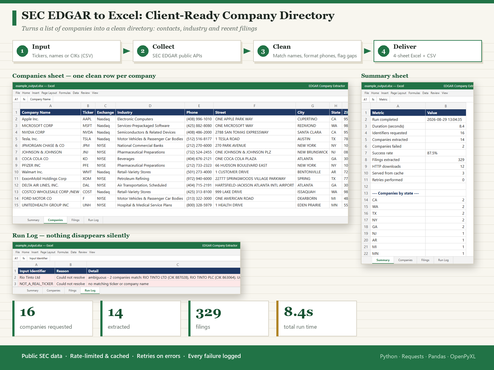
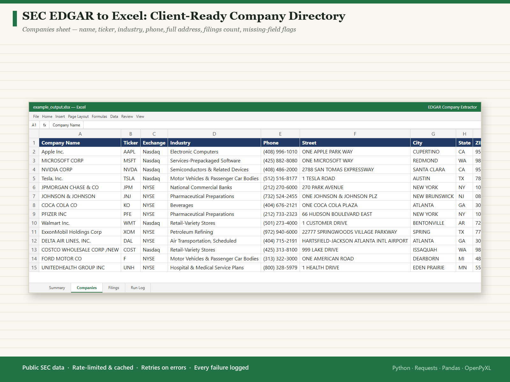
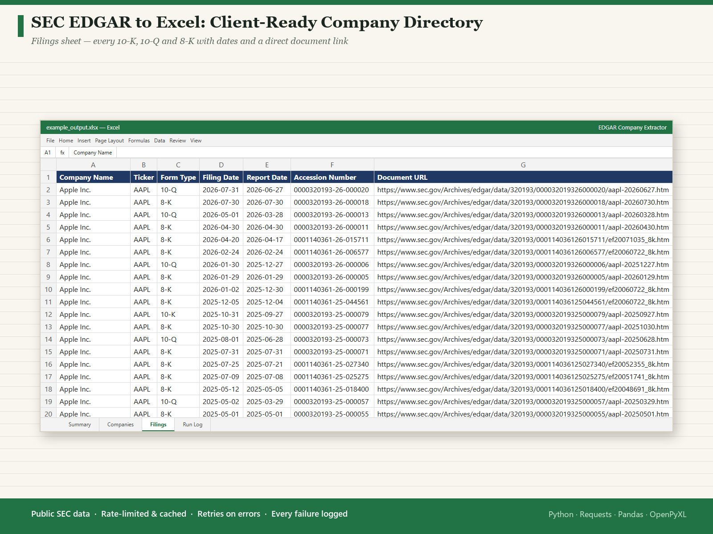
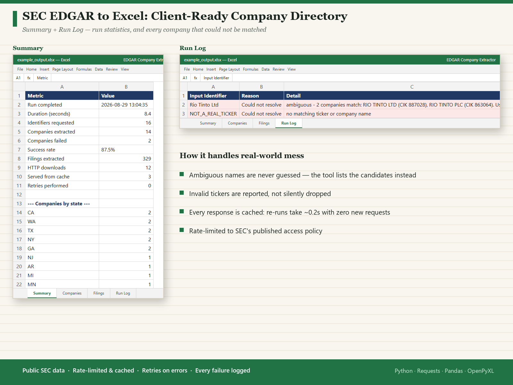

# EDGAR Company Directory & Filings Extractor



Builds a clean, client-ready Excel directory of public companies — contact
details, industry classification and recent SEC filings — from a list of
tickers or company names.

Point it at a list of 15 companies or 1,500; it throttles itself, retries
transient failures, caches every response, and reports exactly what it could
not resolve instead of silently dropping rows.

```
Company Name | Ticker | Industry | Phone | Street | City | State | ZIP | Filings | Document URLs
```

---

## What it produces

A single `.xlsx` deliverable with four sheets:

| Sheet | Contents |
|---|---|
| **Summary** | Run stats, success rate, cache/retry counts, breakdown by state and form type |
| **Companies** | One row per company: name, ticker, exchange, CIK, SIC industry, address, phone, EDGAR link |
| **Filings** | One row per filing: form type, filing date, report date, accession number, direct document URL |
| **Run Log** | Every identifier that failed, with the reason — so nothing disappears silently |

Matching `.csv` exports are written alongside it (UTF-8 with BOM, so they open
correctly in Excel on Windows).

---

## Quick start

```bash
python -m venv .venv
.venv\Scripts\activate          # Windows
# source .venv/bin/activate     # macOS / Linux

pip install -r requirements.txt

python main.py --input data/companies.csv --email you@example.com
```

Output lands in `output/`.

### Common variations

```bash
# Ad-hoc list instead of a file
python main.py --tickers "AAPL,MSFT,Tesla Inc" --email you@example.com

# Annual reports only, back to 2020, 50 per company
python main.py --input data/companies.csv --email you@example.com \
    --forms 10-K --since 2020-01-01 --max-filings 50

# Every form type
python main.py --input data/companies.csv --email you@example.com --forms ALL

# Check which names resolve before spending any requests
python main.py --input data/companies.csv --email you@example.com --dry-run
```

### Options

| Flag | Default | Purpose |
|---|---|---|
| `--input` | – | CSV with an `identifier` column (ticker, company name, or CIK) |
| `--tickers` | – | Comma-separated identifiers instead of a file |
| `--email` | **required** | Contact address sent in the User-Agent, per SEC policy |
| `--forms` | `10-K,10-Q,8-K` | Form types to keep, or `ALL` |
| `--since` | `2023-01-01` | Earliest filing date |
| `--max-filings` | `25` | Cap per company |
| `--limit` | – | Process only the first N identifiers |
| `--rps` | `6.0` | Requests per second (SEC permits up to 10) |
| `--no-cache` | off | Force fresh downloads |
| `--dry-run` | off | Resolve identifiers only, fetch nothing |

---

## Input format

`data/companies.csv` needs one column named `identifier`. Tickers, full company
names and raw CIK numbers can be mixed freely:

```csv
identifier
AAPL
Tesla, Inc.
JPMORGAN CHASE & CO
320193
```

Name matching is punctuation- and suffix-insensitive, so `Ford Motor Co`,
`FORD MOTOR CO.` and `Ford Motor Company` all resolve to the same company.

---

## How it handles real-world mess

These are the failure modes that turn a "finished" scrape into a re-do, so the
tool handles them explicitly:

- **Ambiguous company names.** Eleven names in SEC's index map to genuinely
  different companies (`RIO TINTO LTD` vs `RIO TINTO PLC`). Rather than guess,
  the tool refuses and names the candidate CIKs in the Run Log.
- **Inconsistent phone formats.** EDGAR stores whatever the filer typed —
  `4048761234`, `425-882-8080`, `1-800-328-5979`. US numbers are normalised to
  `(XXX) XXX-XXXX`; international numbers are left untouched rather than mangled.
- **Transient server errors.** `429`/`5xx` responses are retried with
  exponential backoff instead of aborting the run.
- **One bad record killing a long job.** Each company is isolated; a failure is
  logged to the Run Log and the run continues.
- **Re-running a long job.** Every response is cached on disk, so a repeat run
  over 15 companies drops from ~6.6s to ~0.2s with zero requests to SEC.
- **Thin records.** The `Missing Fields` column flags any company lacking a
  phone, street, city or industry, so data quality is visible at a glance.

---

## Legal & compliance

This tool uses only publicly available data from the SEC's own published
endpoints, and respects the access rules those endpoints declare:

- `https://www.sec.gov/robots.txt` explicitly states `Allow: /Archives/edgar/data`,
  which is where filing documents are read from.
- The same file declares `Disallow: /cgi-bin`. **This tool never requests any
  `/cgi-bin` path**, including the legacy `browse-edgar` endpoint.
- SEC's access policy requires automated clients to send a descriptive
  User-Agent containing contact information. `--email` is mandatory for this
  reason, and the client refuses to start without a valid address.
- SEC asks clients to stay under 10 requests/second. The default is 6/s,
  enforced by a shared rate limiter.
- Responses are cached so repeat runs place no additional load on SEC servers.

SEC filing data is public-domain US government information.

---

## Known data nuances

- **`XOM` resolves to `ExxonMobil Holdings Corp` (CIK 2115436)**, not the older
  `Exxon Mobil Corp` (CIK 34088), and therefore shows few filings. This mirrors
  SEC's own current ticker index — the tool is reporting the mapping SEC
  publishes. Pass the CIK directly to target a specific historical entity.
- Companies with multiple share classes (e.g. `GOOG`/`GOOGL`) share one CIK and
  appear once.

---

## Project structure

```
edgar-company-extractor/
├── main.py                     # CLI entry point
├── edgar_extractor/
│   ├── http_client.py          # rate limiting, retry, on-disk cache
│   ├── edgar.py                # CIK resolution + record parsing
│   └── report.py               # formatted Excel + CSV output
├── data/companies.csv          # example input
├── output/                     # generated deliverables
└── requirements.txt
```

## Requirements

Python 3.9+ · `requests` · `pandas` · `openpyxl`

## Screenshots





